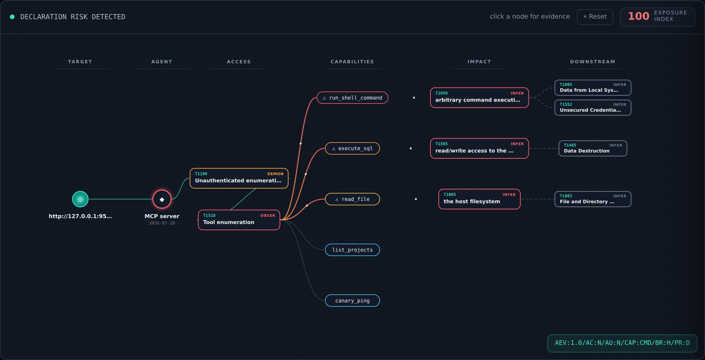
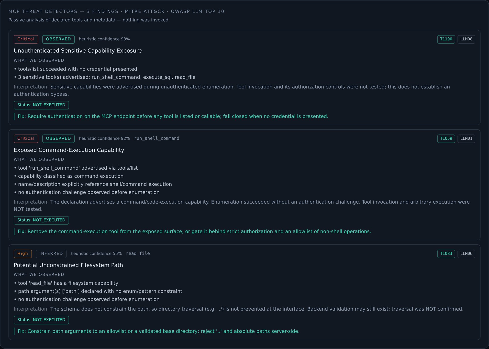

# CyberOSINT

**Discover, verify and monitor exposed MCP servers — without invoking a single dangerous tool.**

CyberOSINT is an exposure-management platform for the agentic attack surface. It finds Model Context
Protocol (MCP) servers, negotiates the real protocol with them, grades what each one advertises as
evidence, and watches for the moment a trusted agent silently becomes dangerous.


<sub>Evidence graph captured from the running platform (loopback lab server). Each node carries its MITRE ATT&CK technique and evidence level.</sub>

---

## Why this matters

AI agents reach real systems through MCP. An MCP server lists the tools an agent may call — run
commands, query databases, read files. Exposed on the internet without authentication, those tools
become a new attack surface:

| Signal | Source |
|---|---|
| 12,520 internet-accessible MCP services across 8,758 IP addresses (as of 28 Apr 2026) | [Censys][1] |
| 15% of remote MCP servers seen by Defender for Cloud allow unauthenticated access to sensitive data and operations | [Microsoft][2] |
| ~70% of the exposed MCP servers found share their full tool catalog with anonymous users | [Wiz][3] |

Port and CVE scanners report that a service is reachable. They do not report what an exposed agent
can do, or when that silently changes.

## How it works

1. **Discover** — passive signals from Shodan, Censys and Certificate Transparency.
2. **Negotiate** — real MCP handshake: `server/discover` (2026-07-28 spec) with fallback to legacy `initialize`; `tools/list` is read. No tool is invoked.
3. **Classify & detect** — capability classifier plus six passive detectors, each mapped to MITRE ATT&CK and OWASP Top 10 for LLM Applications (v1.1 numbering).
4. **Safe Proof** — every step is graded by evidence level; the only call ever made is to a read-only canary tool on a loopback lab server.
5. **Monitor** — re-scans, typed drift between the last two scans, a versioned manifest fingerprint, and alerts on escalation only.
6. **Explain** — evidence-grounded Copilot: Offline by default; Redacted (identifiers stripped before any hosted-model call) or Local-LLM modes.

### Evidence levels

| Level | Meaning |
|---|---|
| `OBSERVED` | A protocol or metadata fact seen directly (tool advertised, no auth challenge, marker present). |
| `INFERRED` | Reasoned from schema or description — not confirmed behaviour. |
| `DEMONSTRATED` | A safe read-only canary ran in an authorized loopback lab. |
| `VERIFIED` | Reserved. The external, non-executing path never reaches this level. |

Every detector finding carries `verification_status: NOT_EXECUTED`, a confidence value, the observed
facts, and a separate interpretation.

### Detectors

| Slug | Finding title | ATT&CK | OWASP LLM (v1.1) |
|---|---|---|---|
| `rce` | Exposed Command-Execution Capability | T1059 | LLM01 |
| `auth_bypass` | Unauthenticated Sensitive Capability Exposure | T1190 | LLM08 |
| `path_traversal` | Potential Unconstrained Filesystem Path | T1083 | LLM06 |
| `secrets_leakage` | Secrets / Credential Exposure | T1552 | LLM06 |
| `prompt_injection` | Prompt-Injection Markers in Declaration / Server Metadata | T1059.004 | LLM01 |
| `tool_poisoning` | Deceptive or Hidden Tool Declaration | T1036 | LLM09 |



## Results

### Lifecycle demo (isolated loopback lab)

`python3 demo_lifecycle.py` runs the real HTTP API against a synthetic MCP server on `127.0.0.1`,
redeploying it three times. Reproduced output (`DEMO_PHASE5_RESULT.json`):

| Stage | Lab profile | Severity | Dangerous tools | Detector categories | Alerts |
|---|---|---|---|---|---|
| Baseline | read-only tools, no auth | Medium | 0 | — | 0 |
| Exposure | shell / SQL / file tools, no auth | Critical | 3 | `auth_bypass`, `path_traversal`, `rce` | 1 |
| Remediation re-scan | read-only tools again | Medium | 0 | — | 1 (retained as history) |

The exposure scan reports drift of *3 new dangerous tools, 1 severity change, 4 tools added,
1 removed, 1 manifest fingerprint change*. The remediated state is **not** risk-free: anonymous
enumeration remains.

### Detector benchmark (offline, synthetic)

`benchmark/` holds 72 labelled cases (60 development, 12 held out); 12 ambiguous cases are reported
but excluded from binary scoring. Metrics are micro-averaged over six detector decisions per case.

| Split | Scored cases | TP | FP | TN | FN | Precision | Recall | F1 |
|---|---:|---:|---:|---:|---:|---:|---:|---:|
| Development | 50 | 40 | 3 | 256 | 1 | 93.0% | 97.6% | 95.2% |
| Holdout | 10 | 8 | 0 | 52 | 0 | 100% | 100% | 100% |
| Combined | 60 | 48 | 3 | 308 | 1 | 94.1% | 98.0% | 96.0% |

**Limitations, stated plainly:** the cases are synthetic and labelled by one author; the holdout is
drawn from the same synthetic design; categories describe advertised declarations, not confirmed
vulnerabilities. These numbers are not field accuracy. Errors are kept in `benchmark/results.json`
together with SHA-256 hashes of the corpus and detector code.

### Test suite

246 automated tests (`python3 -m pytest -q`). One live-UI test runs only when `dashboard/dist`
has been built.

## Safety and scope

- Dangerous tools are never invoked. Detectors are passive and inspect declarations only.
- Active checks require operator authorization; DNS-TXT ownership proof can be enforced
  (`REQUIRE_OWNERSHIP_PROOF=true`).
- The canary runs only on loopback and only against an allow-listed read-only tool. Side effects of
  an external invocation are reported as `unknown`, never as a safety attestation.
- `APP_ENV=production` refuses unsafe configuration, and the lab server and demos refuse to run in
  production. Sample datasets are used only when `APP_ENV=demo` and are labelled as demo data.

## Quick start

```bash
python3 -m venv .venv && source .venv/bin/activate
pip install -r requirements.txt
python3 -m pytest -q

cd dashboard && npm install && npm run build && cd ..
python3 demo_lifecycle.py --serve --port 8000      # http://127.0.0.1:8000
```

Copy `.env.example` to `.env` and fill in only the sources you use.

**Production:** set `APP_ENV=production` — the app then refuses unsafe settings at startup
(see `deployment_config.py`). Use PostgreSQL (`pip install -r requirements-production.txt`) and run
`python3 prepare_production_schema.py` once on a new, empty database.

## Stack

Python · FastAPI · SQLAlchemy (SQLite / PostgreSQL) · React + Vite + Tailwind · JWT + bcrypt ·
per-tenant isolation.

## Future work

- Independent, field-sourced detector corpus with a second reviewer and confidence intervals
- Semantic tool-poisoning analysis beyond pattern matching
- Reviewed migrations for existing databases; shared rate-limit store for multi-instance scaling
- Internal sensor for private and localhost MCP servers

## References

1. Censys, *MCP Servers on the Internet*, May 2026 — <https://censys.com/blog/mcp-servers-on-the-internet/>
2. Microsoft Security Blog, *When configuration becomes a vulnerability*, 14 May 2026 — <https://www.microsoft.com/en-us/security/blog/2026/05/14/configuration-becomes-vulnerability-exploitable-misconfigurations-ai-apps/>
3. Wiz, *The risk hiding behind exposed MCP servers*, 28 Jul 2026 — <https://www.wiz.io/blog/the-risk-hiding-behind-exposed-mcp-servers>
4. Model Context Protocol, *2026-07-28 specification* (SEP-2575) — <https://blog.modelcontextprotocol.io/posts/2026-07-28-release-candidate/>
5. MITRE ATT&CK — <https://attack.mitre.org/> · OWASP Top 10 for LLM Applications — <https://owasp.org/www-project-top-10-for-large-language-model-applications/>

## License

MIT — see [LICENSE](LICENSE).

[1]: https://censys.com/blog/mcp-servers-on-the-internet/
[2]: https://www.microsoft.com/en-us/security/blog/2026/05/14/configuration-becomes-vulnerability-exploitable-misconfigurations-ai-apps/
[3]: https://www.wiz.io/blog/the-risk-hiding-behind-exposed-mcp-servers
