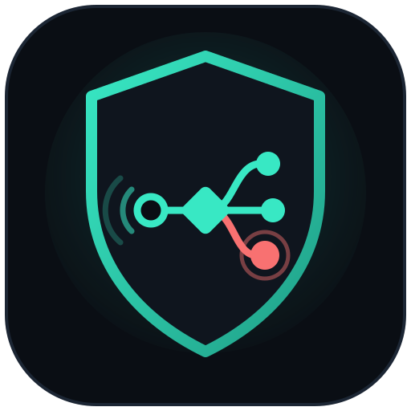
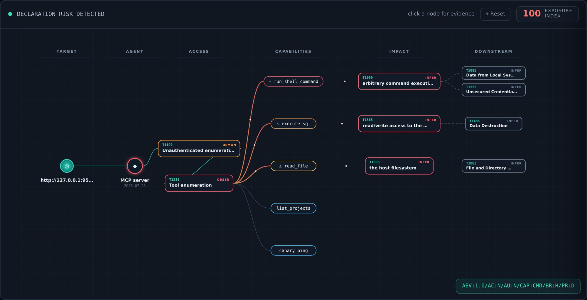

<p align="center">
  
</p>

<h1 align="center">Raqeeb</h1>

<p align="center">
  Find exposed MCP servers, read what they declare, and notice when that changes.<br>
  No dangerous tool is ever invoked.
</p>

<p align="center">
  <a href="https://github.com/RootSec01/CyberOSINT/actions/workflows/tests.yml"></a>
  <a href="https://github.com/RootSec01/CyberOSINT/actions/workflows/observatory.yml"></a>
  <a href="LICENSE"></a>
</p>



AI agents reach real systems through the Model Context Protocol. An MCP server lists the tools an
agent may call: run a command, query a database, read a file. Port and CVE scanners can tell you the
server is reachable. They cannot tell you what an agent connected to it is able to do, or that the
answer changed after last week's redeploy.

Raqeeb is entered in SAIF 2026 under the name CyberOSINT.

## What it does

1. **Discover** MCP servers tied to an organization from Shodan, Censys and Certificate Transparency.
2. **Negotiate** the real protocol (`server/discover`, falling back to `initialize`) and read `tools/list`.
3. **Classify** each declared tool by capability and run six passive detectors over the declarations.
4. **Grade** every statement by how it was established (see evidence levels).
5. **Monitor** each server: typed drift between scans, a manifest fingerprint, alerts on escalation only.

## Field study

`observatory/` re-reads a fixed sample of public MCP servers every day and records what each one
declares. The sample was drawn once, with a fixed seed, from the official MCP Registry
(62,855 records read; 35,077 credential-free remote endpoints on 26,445 hosts; 500 sampled, one per
host).

First full snapshot, 14 November 2026:

| Outcome | Endpoints |
|---|---:|
| Listed its tools with no credentials | 297 |
| Asked for authentication | 149 |
| Listed in the registry but not answering as MCP | 32 |
| Unreachable | 21 |
| Resolved to a non-public address, not contacted | 1 |

A second run from a different network 73 minutes later reached 303 servers, and all 297 seen from
both places returned identical tool declarations. Method, data layout and opt-out are described in
[observatory/README.md](observatory/README.md). Every run is a commit in this repository.

## Evidence levels

| Level | Meaning |
|---|---|
| `OBSERVED` | A protocol or metadata fact seen directly. |
| `INFERRED` | Reasoned from a schema or description. Not confirmed behaviour. |
| `DEMONSTRATED` | A read-only canary ran against an authorized loopback lab server. |
| `VERIFIED` | Reserved. The external, non-executing path never reaches it. |

## Detectors

| Slug | Finding | MITRE | OWASP MCP Top 10 |
|---|---|---|---|
| `rce` | Exposed command-execution capability | T1059 | MCP05 |
| `open_capability` | Sensitive capability listed without authentication | T1190 | MCP07 |
| `path_traversal` | Potentially unconstrained filesystem path | T1083 | none |
| `secrets_leakage` | Secret or credential exposure | T1552 | MCP01 |
| `prompt_injection` | Prompt-injection markers in a declaration | AML.T0051.001 (ATLAS) | MCP06 |
| `tool_poisoning` | Deceptive or hidden tool declaration | T1036 | MCP03 |

`path_traversal` has no close OWASP MCP Top 10 category and is left unmapped.

## Results on synthetic data

**Lifecycle demo.** `python3 -m lab.lifecycle` drives the real HTTP API against a loopback MCP server
that is redeployed three times (`lab/lifecycle_result.json`):

| Stage | Lab profile | Severity | Dangerous tools | Alerts |
|---|---|---|---:|---:|
| Baseline | read-only tools, no auth | Medium | 0 | 0 |
| Exposure | shell, SQL and file tools, no auth | Critical | 3 | 1 |
| Remediation | read-only tools again | Medium | 0 | 1 (kept as history) |

**Detector benchmark.** 72 labelled declarations in `benchmark/`, 12 of them ambiguous and excluded
from scoring.

| Split | Scored | TP | FP | TN | FN | Precision | Recall | F1 |
|---|---:|---:|---:|---:|---:|---:|---:|---:|
| Development | 50 | 40 | 3 | 256 | 1 | 93.0% | 97.6% | 95.2% |
| Holdout | 10 | 8 | 0 | 52 | 0 | 100% | 100% | 100% |
| Combined | 60 | 48 | 3 | 308 | 1 | 94.1% | 98.0% | 96.0% |

These cases are synthetic and were labelled by one author, and the holdout comes from the same
design. They measure regression, not field accuracy.

## Run it

```bash
python3 -m venv .venv && source .venv/bin/activate
pip install -r requirements.txt
python3 -m pytest -q

cd dashboard && npm install && npm run build && cd ..
python3 -m lab.lifecycle --serve --port 8000        # http://127.0.0.1:8000
```

To run the API on its own: copy `.env.example` to `.env`, then `uvicorn raqeeb.main:app`.

With `APP_ENV=production` the application refuses unsafe settings at startup
(`raqeeb/deployment_config.py`). Use PostgreSQL (`requirements-production.txt`) and run
`python3 -m raqeeb.prepare_production_schema` once on a new, empty database.

## Safety and scope

- Detectors read declarations only. No tool on a third-party server is ever called.
- Active checks need operator authorization, and DNS TXT ownership proof can be enforced.
- The canary runs only on loopback, against an allow-listed read-only tool.
- The lab server and the demos refuse to start in production.

## Layout

```
raqeeb/        platform: API, protocol negotiation, detectors, drift, storage
observatory/   daily field study of public MCP servers, with its data
lab/           loopback MCP server and the lifecycle demo
benchmark/     labelled declarations and the offline scorer
dashboard/     React interface
tests/         test suite
```

## References

1. Censys, *MCP Servers on the Internet*, May 2026. <https://censys.com/blog/mcp-servers-on-the-internet/>
2. Microsoft Security Blog, *When configuration becomes a vulnerability*, 14 May 2026. <https://www.microsoft.com/en-us/security/blog/2026/05/14/configuration-becomes-vulnerability-exploitable-misconfigurations-ai-apps/>
3. Wiz, *The risk hiding behind exposed MCP servers*, 28 Jul 2026. <https://www.wiz.io/blog/the-risk-hiding-behind-exposed-mcp-servers>
4. OWASP MCP Top 10. <https://owasp.org/www-project-mcp-top-10/>
5. MITRE ATT&CK <https://attack.mitre.org/> and MITRE ATLAS <https://atlas.mitre.org/>

## License

MIT. See [LICENSE](LICENSE).
