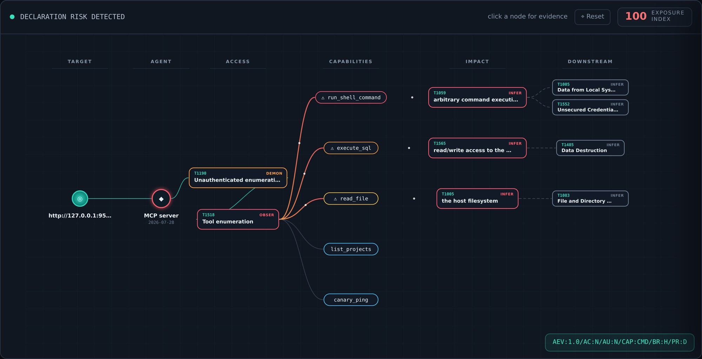

<p align="center">
  
</p>

<h1 align="center">Raqeeb</h1>

<p align="center">
  Find exposed MCP servers, read what they declare, and notice when that changes.<br>
  No dangerous tool is ever invoked.
</p>

<p align="center">
  <a href="https://github.com/RootSec01/CyberOSINT/actions/workflows/tests.yml"></a>
  <a href="https://github.com/RootSec01/CyberOSINT/actions/workflows/observatory.yml"></a>
  <a href="LICENSE"></a>
</p>



AI agents reach real systems through the Model Context Protocol. An MCP server lists the tools an
agent may call: run a command, query a database, read a file. Port and CVE scanners can tell you the
server is reachable. They cannot tell you what an agent connected to it is able to do, or that the
answer changed after last week's redeploy.

Raqeeb is entered in SAIF 2026 under the name CyberOSINT.

## What it does

1. **Discover** MCP servers tied to an organization from Shodan, Censys and Certificate Transparency.
2. **Negotiate** the real protocol (`server/discover`, falling back to `initialize`) and read `tools/list`.
3. **Classify** each declared tool by capability and run six passive detectors over the declarations.
4. **Grade** every statement by how it was established (see evidence levels).
5. **Monitor** each server: typed drift between scans, a manifest fingerprint, alerts on escalation only,
   and a lifecycle for every exposure: open, proven closed, or back after a fix.

## Field study

`observatory/` re-reads a fixed sample of public MCP servers every day and records what each one
declares. The sample was drawn once, with a fixed seed, from the official MCP Registry
(62,855 records read; 35,077 credential-free remote endpoints on 26,445 hosts; 500 sampled, one per
host).

First full snapshot, 14 November 2026:

| Outcome | Endpoints |
|---|---:|
| Listed its tools with no credentials | 297 |
| Asked for authentication | 149 |
| Listed in the registry but not answering as MCP | 32 |
| Unreachable | 21 |
| Resolved to a non-public address, not contacted | 1 |

A second run from a different network 73 minutes later reached 303 servers, and all 297 seen from
both places returned identical tool declarations. Method, data layout and opt-out are described in
[observatory/README.md](observatory/README.md). Every run is a commit in this repository.

## Reference library

Drift detection compares a server with its own earlier state, so a server that was altered before
the first scan becomes its own baseline. `reference/` adds a second point of comparison: what the
package's publisher actually shipped. Each stable npm release of 30 widely used MCP server packages
was installed in a throwaway directory, started over stdio and asked for `tools/list`.

| | |
|---|---:|
| Releases installed | 706 |
| Releases that listed their tools | 673 |
| Distinct tool manifests | 336 |
| Release-to-release steps | 643 |
| Steps where the declarations changed | 310 |
| Steps that added at least one tool | 96 |
| Steps that only redefined existing tools | 201 |

`python3 -m reference summary` reproduces the table. Given a server's `tools/list`, `identify`
answers `match`, `subset`, `deviation` or `unknown` and names the release and the tools that differ
([reference/README.md](reference/README.md)).

Every scan now carries this verdict. `python3 -m lab.tampering` serves the published
`server-filesystem` 2.3.0 declarations twice on loopback, once as shipped and once with a hidden
sentence appended to one description. Both are first scans, so drift has nothing to compare:
the first is reported as `match`, the second as `deviation` naming `read_file`, with the published
and observed text side by side and an alert (`lab/tampering_result.json`).

None of the 287 hosted servers in the field study is a deployment of these 30 packages; all are
`unknown`. The library applies to self-hosted deployments of published packages, not to bespoke
hosted services.

## Evaluation on third-party material

`evaluation/` scores the platform on servers and data it did not write. What would count as a
result was written down before each run, and the `evaluation` workflow produces the result files
from pinned commits of the sources.

**Damn Vulnerable MCP Server**, 15 challenges, handshake and `tools/list` only
([expectations](evaluation/dvmcp_expectations.json), [results](evaluation/dvmcp_results.json)):

| | |
|---|---:|
| Weakness visible in what the server declares (in scope) | 6 |
| Detected | 5 |
| Missed (challenge 9: nothing in the declaration shows the tool reaches a shell) | 1 |
| Weakness needs a tool call or lies in server logic (out of scope) | 9 |

This run also showed that the protocol client did not carry the session id that servers built with
the official SDK require, and read zero tools from them. That is fixed and covered by a test.

**MCPTox** (AAAI 2026), 485 poisoned tool descriptions written for 45 real servers, against 2,121
distinct tool declarations from the reference library as the clean set
([protocol](evaluation/mcptox_protocol.json), [results](evaluation/mcptox_results.json)). The result
is in the results file; the pattern-based poisoning and injection detectors were expected to do badly
on fluent natural-language poisonings, and they do. Detecting an altered declaration by comparing it
with the published release does not depend on how the alteration is worded, which is why the
reference library exists.

## Evidence levels

| Level | Meaning |
|---|---|
| `OBSERVED` | A protocol or metadata fact seen directly. |
| `INFERRED` | Reasoned from a schema or description. Not confirmed behaviour. |
| `DEMONSTRATED` | A read-only canary ran against an authorized loopback lab server. |
| `VERIFIED` | Reserved. The external, non-executing path never reaches it. |

## Exposure lifecycle

Drift says what changed between the last two scans. The lifecycle keeps the standing answer per
asset, for every dangerous tool, anonymous access and CVE (`raqeeb/exposure_state.py`):

| State | Meaning |
|---|---|
| `open` | Seen by the latest scan that could see it. |
| `remediated` | Absent from a later scan whose evidence proves the absence. The scan, the manifest fingerprint and the reason are stored. |
| `regressed` | Remediated, then seen again. The alert that fires anyway says the exposure returned. |

Presence is always evidence; absence is evidence only when the scan could have seen the exposure.
Otherwise the exposure is held open and the reason is recorded:

- a skipped, unauthorized or simulated scan, or an unconfirmed MCP server, changes nothing;
- tools close only when `tools/list` was read to the last page without an error;
- anonymous access closes only when the scan observed authentication being required;
- CVEs close only when the report holds the complete list, not the top 15;
- surface scans never close MCP exposures, and the other way round.

Identity comes from the manifest snapshot drift already stores. A tool whose declaration changes
keeps its history (`definition changed`). A tool renamed with an identical declaration moves to the
new name instead of being closed and reopened. A tool still declared but no longer dangerous is
closed with that reason, separately from one that was removed.

`GET /api/assets/{id}/exposures` returns the states (`?state=exposed` for open and regressed), and
the Assets page shows them under **Lifecycle**.

## Detectors

| Slug | Finding | MITRE | OWASP MCP Top 10 |
|---|---|---|---|
| `rce` | Exposed command-execution capability | T1059 | MCP05 |
| `open_capability` | Sensitive capability listed without authentication | T1190 | MCP07 |
| `path_traversal` | Potentially unconstrained filesystem path | T1083 | none |
| `secrets_leakage` | Secret or credential exposure | T1552 | MCP01 |
| `prompt_injection` | Prompt-injection markers in a declaration | AML.T0051.001 (ATLAS) | MCP06 |
| `tool_poisoning` | Deceptive or hidden tool declaration | T1036 | MCP03 |

`path_traversal` has no close OWASP MCP Top 10 category and is left unmapped.

## Results on synthetic data

**Lifecycle demo.** `python3 -m lab.lifecycle` drives the real HTTP API against a loopback MCP server
that is redeployed three times (`lab/lifecycle_result.json`):

| Stage | Lab profile | Severity | Dangerous tools | Alerts |
|---|---|---|---:|---:|
| Baseline | read-only tools, no auth | Medium | 0 | 0 |
| Exposure | shell, SQL and file tools, no auth | Critical | 3 | 1 |
| Remediation | read-only tools again | Medium | 0 | 1 (kept as history) |

**Detector benchmark.** 72 labelled declarations in `benchmark/`, 12 of them ambiguous and excluded
from scoring.

| Split | Scored | TP | FP | TN | FN | Precision | Recall | F1 |
|---|---:|---:|---:|---:|---:|---:|---:|---:|
| Development | 50 | 40 | 3 | 256 | 1 | 93.0% | 97.6% | 95.2% |
| Holdout | 10 | 8 | 0 | 52 | 0 | 100% | 100% | 100% |
| Combined | 60 | 48 | 3 | 308 | 1 | 94.1% | 98.0% | 96.0% |

These cases are synthetic and were labelled by one author, and the holdout comes from the same
design. They measure regression, not field accuracy.

## Run it

```bash
python3 -m venv .venv && source .venv/bin/activate
pip install -r requirements.txt
python3 -m pytest -q                               # 323 tests

cd dashboard && npm install && npm run build && cd ..
python3 -m lab.lifecycle --serve --port 8000        # http://127.0.0.1:8000
```

To run the API on its own: copy `.env.example` to `.env`, then `uvicorn raqeeb.main:app`.

With `APP_ENV=production` the application refuses unsafe settings at startup
(`raqeeb/deployment_config.py`). Use PostgreSQL (`requirements-production.txt`) and run
`python3 -m raqeeb.prepare_production_schema` once on a new, empty database. A database created
before the exposure lifecycle needs one reviewed step, which is a dry run unless told to apply:

```bash
python3 -m raqeeb.migrations            # lists pending migrations
python3 -m raqeeb.migrations --apply    # adds exposure_states, then runs the readiness check
```

CI runs the suite on Linux, macOS and Windows with SQLite, and the lifecycle and migration tests
against PostgreSQL 16.

## Safety and scope

- Detectors read declarations only. No tool on a third-party server is ever called.
- Active checks need operator authorization, and DNS TXT ownership proof can be enforced.
- The canary runs only on loopback, against an allow-listed read-only tool.
- The lab server and the demos refuse to start in production.

## Layout

```
raqeeb/        platform: API, protocol negotiation, detectors, drift, storage
observatory/   daily field study of public MCP servers, with its data
reference/     what published MCP server packages declare, release by release
lab/           loopback MCP server and the lifecycle demo
benchmark/     labelled declarations and the offline scorer
evaluation/    scoring against third-party vulnerable servers
dashboard/     React interface
tests/         test suite
```

## References

1. Censys, *MCP Servers on the Internet*, May 2026. <https://censys.com/blog/mcp-servers-on-the-internet/>
2. Microsoft Security Blog, *When configuration becomes a vulnerability*, 14 May 2026. <https://www.microsoft.com/en-us/security/blog/2026/05/14/configuration-becomes-vulnerability-exploitable-misconfigurations-ai-apps/>
3. Wiz, *The risk hiding behind exposed MCP servers*, 28 Jul 2026. <https://www.wiz.io/blog/the-risk-hiding-behind-exposed-mcp-servers>
4. OWASP MCP Top 10. <https://owasp.org/www-project-mcp-top-10/>
5. MITRE ATT&CK <https://attack.mitre.org/> and MITRE ATLAS <https://atlas.mitre.org/>

## License

MIT. See [LICENSE](LICENSE).
